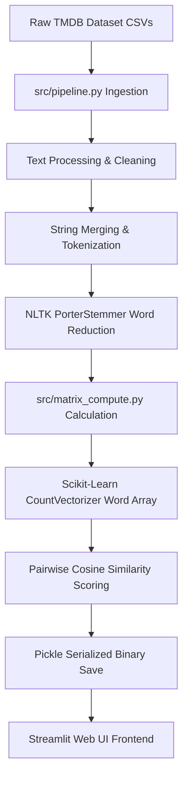

# 🎬 Movie Recommendation System using Text Proximity Mapping

This repository contains the Python source code for a content-based movie recommendation engine. The system converts raw textual metadata (genres, titles, keywords, and cast lists) into numeric text arrays to find and suggest similar films based on text overlap.

The project serves as a practical implementation of **Information Retrieval (IR)** and **Content-Based Filtering (CBF)** models built for web-based exploration.

---

### 📐 Data Pipeline & Application Architecture



---

## 🏗️ Algorithmic Layout & Matching Mechanics

Recommendation pipelines must convert unstructured text descriptions into reliable data matrices without running out of server memory. This system maps movie metadata using a natural language processing (NLP) workflow:

### 1. Text Transformation & Tokenization
Text summaries, keywords, and categories are extracted from the dataset and split into individual word units (tokens):
* **Word Root Reduction:** Uses the **NLTK PorterStemmer** utility to reduce different grammatical versions of words down to their common root forms (e.g., "running" and "runs" both map to "run"). This lowers the total number of unique dictionary entries.
* **Feature Limit Bounds:** Words are converted into numerical columns using a dictionary limit via `CountVectorizer(max_features=5000)` to capture only the most meaningful vocabulary components.
* **Noise Filtering:** The pipeline filters out common English stop words (like "the", "and", "is") to ensure the scoring matches literal content themes rather than repetitive grammatical noise.

### 2. Matching Text Proximity via Cosine Similarity
To assess how closely two movies match, the app measures the directional angle between their keyword matrices rather than absolute counts. This score is calculated using the standard **Cosine Similarity** formula:

$$\text{Similarity}(A, B) = \cos(\theta) = \frac{A \cdot B}{\Vert{}A\Vert{} \Vert{}B\Vert{}} = \frac{\sum_{i=1}^{n} A_i B_i}{\sqrt{\sum_{i=1}^{n} A_i^2} \sqrt{\sum_{i=1}^{n} B_i^2}}$$

* **Proximity Sorting:** A similarity score near `1.0` shows a high text overlap, enabling the application to locate and display the top similar movie choices.
* **Bypassing the Cold Start:** Because this method matches text relationships directly instead of relying on real user history or voting databases, it completely avoids the classic cold-start problem where new or unrated movies cannot get recommended.

---


## 📊 Process Complexity & Performance Roadmap

### 1. Code Complexity Analysis
*   **Time Complexity:** Core token mapping scales at $O(N \cdot M)$ using sparse data frames. Finding pairwise cross-over options operates at a quadratic cost of $O(N^2 \cdot M)$ across the $N=4806$ movie data records.
*   **Space Complexity:** The core similarity lookup grid uses a fixed memory allocation of $O(N^2)$ inside local system memory (RAM).

### 2. Planned System Upgrades
*   Move the current matching lookup loop away from full database scans toward **Approximate Nearest Neighbor (ANN)** graph index models (such as **FAISS** or **HNSW** graphing layers). This transition will optimize lookup execution overhead from a quadratic trajectory down to a sub-linear $O(\log N)$ limit, preparing the app for larger datasets.

---

## ⚙️ Tech Stack & Dependencies

* **Language Platform:** Python (Standard file handling and script execution)
* **Natural Language Processing:** NLTK (PorterStemmer text helper)
* **Data Processing Toolkits:** NumPy, Pandas DataFrames
* **Machine Learning Models:** Scikit-Learn (`CountVectorizer`, Pairwise Metrics)
* **Web UI Framework:** Streamlit Dashboard Engine

---

## 🚀 Setting Up the Local Testing Workspace

### Step 1: Clone the Repository
```bash
git clone https://github.com/Karan-kb/Movie-Recommendation-System.git
cd Movie-Recommendation-System
```

### Step 2: Initialize a Virtual Environment
Create a clean, isolated local workspace to prevent Python library version conflicts:
```bash
python -m venv venv
source venv/bin/activate  # On Windows use: venv\Scripts\activate
pip install -r requirements.txt
```

### Step 3: Run the Web Application
Launch the local web frontend to input search words and view recommended titles instantly:
```bash
streamlit run app.py
```

---

## 👨‍💻 Author

* **Karan B.C.** - Backend Software Engineer | [GitHub Profile](https://github.com/Karan-kb) | [LinkedIn Profile](https://www.linkedin.com/in/karan-b-c-2162a81b8/)
